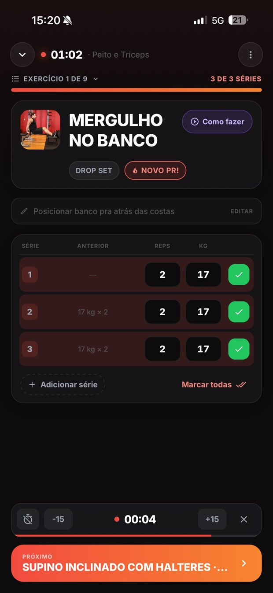
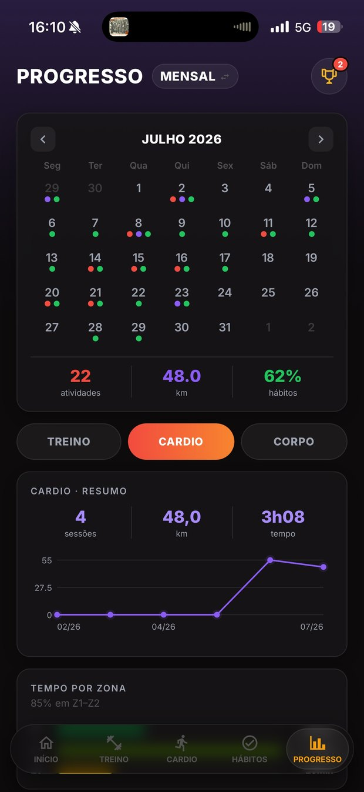
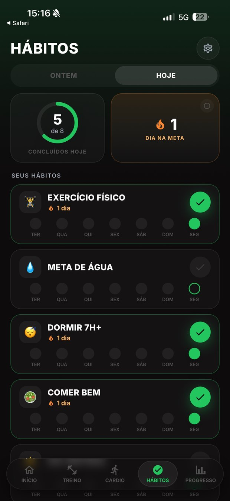

# Forja: case study

**Offline-first training app** for people who take training seriously and mix lifting, HYROX,
functional work and running. Workouts, cardio, programs, habits, body weight and progress live
in one app that works with no connection.

**Try it:** [app.forjahybrid.com](https://app.forjahybrid.com) · **Site:** [forjahybrid.com](https://forjahybrid.com) · **iOS:** [open TestFlight beta](https://testflight.apple.com/join/bRREz5sS)

> This repository is a write-up. It contains **no product source code**: Forja is a
> commercial product under a proprietary license. What follows is the engineering
> reasoning behind it.

**Role:** built solo since March 2026, from architecture and design to CI and release.
**Stack:** React Native (Expo SDK 54) · React 19 · TypeScript strict · Zustand · Supabase (Auth + Postgres + RLS)

---

## Why it exists

I tested the popular training apps and none of them covered all of it, so I built Forja from
what each one did best. Strength, HYROX, functional work and cardio sit next to progress,
habits, body weight and measurements. The whole workout fits on one screen, like a
spreadsheet: tap a set to update weight, reps or time, and correct each station's split after
a HYROX workout.

---

## The constraint that shaped everything

People train in basements, in gyms with no signal, on trails. An app that needs the network
mid-workout is an app that fails exactly when it is being used.

So the device is the **source of truth**, not a cache. Local storage is authoritative; the
server is a backup that reconciles in the background. Every design decision downstream falls
out of that one.

---

## Three problems worth writing about

### 1. Deletion is the hard half of sync

Last-write-wins on updates is easy. The trap is deletion: if a delete is modeled as "row is
gone", any peer that still has the row will helpfully sync it back on the next round, and the
record resurrects. The user deletes a workout, closes the app, reopens it, and it is there again.

Forja stores deletions as **tombstones**, and runs them through the *same* last-write-wins rule
as any other write, compared on `updatedAt`. A delete is not the absence of a record; it is a
record that says "deleted, at this time". Resurrection stops being possible by construction
rather than by patch. The rule is enforced from the client merge down to a Postgres trigger,
and property-based tests simulate two devices with skewed clocks.

### 2. A test suite that runs in UTC cannot see date bugs

A habit tracker lives on the concept of "today". "Today" is a local-timezone question, and the
CI machine runs in UTC, where local day and UTC day are the same day, so **no test can tell
the two apart**. Every off-by-one-day bug passes CI and ships.

The suite therefore has a guard that reruns the day-boundary tests outside UTC: under
`Asia/Tokyo`, where the local day and the UTC day differ, and under `America/New_York` for the
daylight-saving turns. Code that swaps a local date for a UTC one fails there instead of
shipping. It runs on every push, alongside the main suite.

### 3. A rule that CI enforces instead of a document

Screens and components may not import services or the database client directly. Written
down, that rule decays within a month. So it is **enforced**: a CI gate blocks the pull
request that breaks it. The same idea runs through the rest of the repository, where custom
lint rules and audit scripts, themselves covered by tests, check what a reviewer would
otherwise have to remember.

---

## Data protection

Every table carries row-level security with **both** `USING` and `WITH CHECK` scoped to the
authenticated user. `USING` alone is the common mistake: it filters what a user can read, and
leaves them able to *write* rows attributed to someone else. Server-side tests check that one
user cannot reach another's data.

Only the anonymous key ever reaches the client. Build and deploy secrets exist solely in CI.

---

## What is in the product

- **Block-based workouts:** sets, rounds for time, AMRAP, EMOM and intervals, with each block's
  clock running during the session.
- **The whole workout on one screen,** like a spreadsheet. Tap a set to update weight, reps or
  time, and correct each station's split after a HYROX workout.
- **1,256 exercises, 73 ready workouts** (36 of them built around the 8 HYROX stations),
  **6 multi-week programs and 5 run plans.**
- **Cardio** for running, cycling, swimming and brick sessions, logged in km or miles.
- **Progress:** personal records, estimated 1RM, volume by muscle group, a recovery map and
  habit streaks.
- Daily habits, body weight and 13 body metrics, achievements, CSV import and export,
  Sign in with Apple, and account deletion in the app.
- **5,000+ tests.**

## Where it is

Open beta on TestFlight, plus the web app. A full redesign is in progress, with more cardio,
HYROX and functional plans and strength training built for each user.

---

## The app

Screens from before the 2026 redesign.

| Guided session | Session summary | Progress | Habits |
|---|---|---|---|
|  |  |  |  |
| Exercise, set, rest timer, next, with personal records detected mid-session | Volume, duration, sets and records the moment the session ends | Monthly calendar, cardio trends, and time in heart-rate zones | Daily protocol with streaks: logging a workout checks off "exercise" on its own |

## Decisions on record

Architecture decisions are recorded as ADRs in the private repository: framework choice,
offline strategy, backend, state management, UI library, navigation, i18n, the tombstone
LWW rule that resolved problem 1 above, and the block-based workout model.

---

*Questions about any of this are welcome: [LinkedIn](https://www.linkedin.com/in/eduardo-visconti/).*
